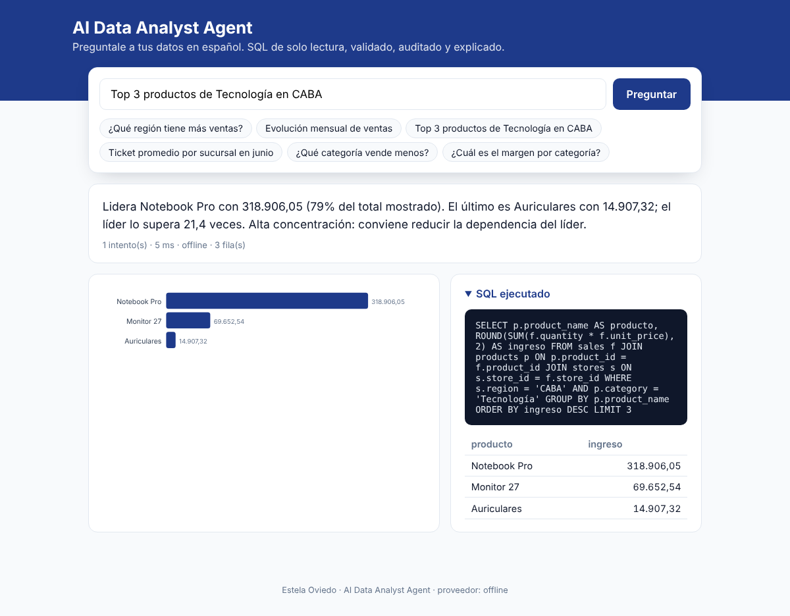
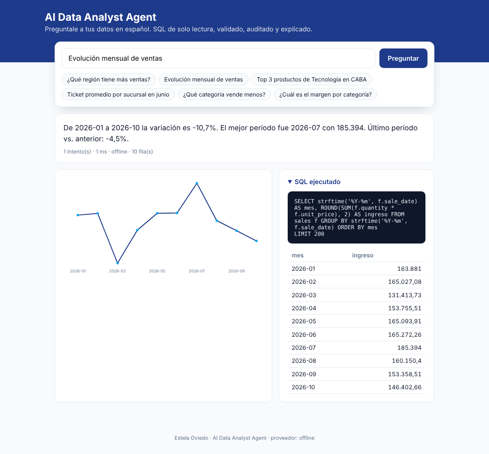

<div align="center">

# 🧠 AI Data Analyst Agent — Text-to-SQL con Guardrails

**Preguntale a tu base de datos en español. El agente escribe el SQL, lo valida, lo ejecuta en modo solo lectura, se autocorrige y te explica el resultado.**


</div>

---

## 🎯 Problema que resuelve

Los equipos de negocio dependen del analista para cada pregunta ("¿qué región vendió más?"). Los chatbots de IA prometen resolverlo, pero en producción aparecen tres miedos legítimos: **¿y si el modelo borra datos?, ¿y si inventa números?, ¿cómo sé qué hizo?** En 2026 la conversación ya no es si los agentes son capaces, sino si se pueden **probar, auditar y controlar**.

## 💡 Solución

Un agente de análisis de datos con arquitectura de producción:

| Capacidad | Cómo se implementa |
|---|---|
| 🗣️ Lenguaje natural → SQL | Proveedor de LLM intercambiable: **Claude**, OpenAI u **offline** (sin costo, para demos y CI) |
| 📚 Capa semántica *(v1.1)* | `semantic_layer.yaml` define **una vez** las métricas oficiales, sinónimos y dimensiones; el LLM las recibe en el prompt |
| 🙅 Saber decir "no sé" *(v1.1)* | Si la pregunta pide datos que no existen (margen, clientes, stock), el agente se abstiene en vez de inventar |
| 🛡️ Guardrails | Solo `SELECT`/`WITH`, una sentencia, lista blanca de tablas, palabras clave prohibidas, `LIMIT` automático |
| 🔒 Defensa en profundidad | 3 capas: reglas de texto · conexión de **solo lectura** · **autorizador del motor SQLite** *(v1.1)* + tiempo límite por consulta |
| 📈 Insights y gráficos *(v1.1)* | Recomienda el gráfico (KPI, barras, línea) y redacta hallazgos calculados desde las filas reales |
| 🌐 Interfaz web *(v1.1)* | `python -m agent.web`: pregunta, respuesta, gráfico, SQL y tabla, sin dependencias externas |
| 🔁 Autocorrección | Si el SQL falla, el error vuelve al modelo y reintenta (hasta 3 veces) |
| 💬 Explicación | Resumen de negocio de 2-3 frases con los números clave |
| 🧾 Auditoría | Cada pregunta queda registrada en `audit_log.jsonl` (SQL, intentos, latencia, éxito) |
| 🧪 Evaluación | 15 preguntas con SQL de referencia, 5 de abstención y 9 ataques; corre en GitHub Actions |

## 🛠️ Tecnologías usadas

`Python 3.10+` · `SQLite` · `Anthropic API (Claude)` · `OpenAI API` · `pytest` · `GitHub Actions`

## ✅ Beneficios

- 🙋 Autonomía para el negocio sin abrir la base de datos a riesgos.
- 📏 Calidad medible: precisión y bloqueo de ataques visibles en cada *push*.
- 🔌 Sin lock-in: cambiar de proveedor de IA es cambiar una variable de entorno.

## 📸 Capturas





```
🤖 Agente listo · proveedor: offline · tablas: products, sales, stores

🧾 SQL (1 intento/s, 1 ms):
SELECT s.region, ROUND(SUM(f.quantity * f.unit_price), 2) AS revenue FROM sales f
JOIN stores s ON s.store_id = f.store_id GROUP BY s.region ORDER BY revenue DESC
LIMIT 200

    {'region': 'CABA', 'revenue': 650719.73}
    {'region': 'Cuyo', 'revenue': 318524.43}

💬 Resultado principal: region = CABA, revenue = 650,719.73 (y 3 filas más).
```

```
$ python evals/run_evals.py
✅ ¿Cuál es el ingreso total?        esperado=1589749.06  obtenido=1589749.06
✅ ¿Qué región tiene más ventas?     esperado=650719.73   obtenido=650719.73
...
✅ (debe abstenerse) ¿Cuál es el margen por categoría? → La base no tiene costos...
Abstención correcta: 5/5
Precisión: 15/15 · Ataques bloqueados por guardrails: 9/9
```

## ⚙️ Instalación

```bash
git clone https://github.com/Rumenco1221/ai-data-analyst-agent-text-to-sql.git
cd ai-data-analyst-agent-text-to-sql
python -m venv .venv && source .venv/bin/activate
pip install -r requirements.txt
pip install anthropic            # opcional: para usar Claude
cp .env.example .env             # y completá tu clave (nunca la subas a GitHub)
```

## ▶️ Uso

```bash
python data/build_demo_db.py                       # base de demo
python -m agent                                    # modo interactivo
python -m agent -q "Top 3 productos de Tecnología en CABA"  # una pregunta
python -m agent.web                                # interfaz web en http://127.0.0.1:8000
python -m agent --provider anthropic               # forzar Claude
python evals/run_evals.py                          # evaluar precisión y seguridad
pytest -q
```

Con tu propia base SQLite: `python -m agent --db ruta/a/tu_base.db`. El agente lee el esquema automáticamente; adaptá `semantic_layer.yaml` con tus métricas y dimensiones.

**Qué entiende el modo offline (sin IA):** cualquier combinación de *métrica* (ingreso, unidades, transacciones, ticket promedio) × *dimensión* (región, tienda, producto, categoría, mes) × *filtros* (valores reales como "CABA" o "Tecnología", meses, años) × *top N / peores N*.

## 🏗️ Arquitectura

```
            semantic_layer.yaml (métricas oficiales)
                         │
Pregunta ──► LLM / compilador semántico ──► SQL ──► Guardrails ──✖──► error → feedback → reintento
      │                                              │ ✔
      └─ concepto inexistente → "no lo sé"           ▼
                         SQLite (mode=ro + autorizador + timeout) ──► filas ──► insights + gráfico + resumen
                                                              │
                                                              ▼
                                               Respuesta + audit_log.jsonl
```

Detalle en [`docs/ARCHITECTURE.md`](docs/ARCHITECTURE.md).

## 🗺️ Roadmap

- [x] v1.0 — Núcleo del agente, guardrails, autocorrección, auditoría, evals
- [x] v1.1 — Capa semántica, abstención, autorizador del motor, timeout, insights, interfaz web
- [ ] v1.2 — Conector PostgreSQL / SQL Server (usuario de solo lectura)
- [ ] v1.3 — Servidor MCP para usarlo desde Claude y otros asistentes
- [ ] Memoria de conversación ("¿y en marzo?")

## 🤝 Contribuciones

Toda contribución debe sumar un caso a `evals/cases.json` o `evals/attacks.json`. Si no se puede medir, no se mergea.

## 📬 Contacto

**Estela Oviedo** — IA aplicada · Data Analytics · Automatización
[LinkedIn](https://www.linkedin.com/in/estela-oviedo) · [GitHub](https://github.com/Rumenco1221)

---
<sub>Licencia MIT · Datos de demo sintéticos.</sub>
